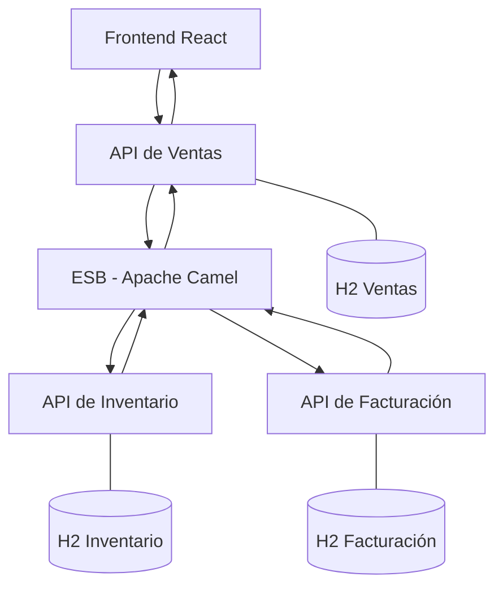

# Kamel Store

## Tienda virtual con integración empresarial mediante Apache Camel

**Prototipo académico de integración de sistemas**  
Universidad Central, Bogotá, Colombia

**Kamel Store** es una aplicación web desarrollada con fines académicos para explorar la integración de sistemas empresariales mediante una arquitectura Enterprise Service Bus (ESB).

El proyecto simula el funcionamiento de una tienda virtual cuyos procesos de ventas, inventario y facturación se encuentran distribuidos en servicios independientes. A través de Apache Camel, estos componentes intercambian información, procesan pedidos y coordinan operaciones sin depender de conexiones directas entre todos los sistemas.

La aplicación incorpora una interfaz desarrollada con React y TypeScript, servicios REST implementados con Spring Boot y persistencia local mediante H2. Su arquitectura permite estudiar conceptos de enrutamiento, transformación de mensajes, desacoplamiento, trazabilidad y manejo de errores.

> Kamel Store es un prototipo académico. Los productos, las transacciones y las facturas son simulados. No se procesan pagos reales ni se emiten documentos tributarios válidos.

## Tecnologías

### Lenguajes y desarrollo

[](https://www.java.com/)
[](https://www.typescriptlang.org/)
[](https://developer.mozilla.org/es/docs/Web/HTML)
[](https://developer.mozilla.org/es/docs/Web/CSS)

### Backend e integración empresarial

[](https://spring.io/projects/spring-boot)
[](https://camel.apache.org/)
[](https://maven.apache.org/)
[](https://www.h2database.com/)

### Frontend e interfaz

[](https://react.dev/)
[](https://vite.dev/)
[](https://lucide.dev/)
[](https://nodejs.org/)

### Herramientas

[](https://git-scm.com/)
[](https://learn.microsoft.com/powershell/)
[](https://zed.dev/)

Las versiones indicadas corresponden al entorno de desarrollo y a las dependencias documentadas para la primera versión del proyecto.

## Funcionalidades principales

### Tienda virtual: interfaz de usuario

El frontend permite interactuar con los servicios de Kamel Store mediante una interfaz web responsive, inspirada visualmente en paisajes desérticos y rutas comerciales.

- Página principal con presentación de la tienda.
- Catálogo de productos obtenido desde los servicios backend.
- Consulta de precios y existencias disponibles.
- Registro de pedidos mediante formularios.
- Visualización del resultado de las compras.
- Consulta del historial y estado de los pedidos.
- Visualización de facturas simuladas.
- Manejo de estados de carga, errores y respuestas del servidor.

La interfaz utiliza React y TypeScript, con componentes reutilizables y comunicación HTTP mediante una API REST.

### Ventas: gestión de pedidos

El servicio de ventas centraliza las solicitudes realizadas desde la interfaz web.

- Recepción y registro de pedidos.
- Asignación y validación de identificadores únicos.
- Consulta de pedidos registrados.
- Seguimiento de estados de procesamiento.
- Comunicación con el ESB para coordinar las operaciones.
- Recuperación de pedidos pendientes de facturación.
- Prevención del procesamiento duplicado de solicitudes.

El servicio actúa como punto de entrada de las operaciones comerciales y evita que el frontend tenga que comunicarse directamente con los demás servicios.

### ESB: integración mediante Apache Camel

El servicio ESB constituye el componente central de la arquitectura de integración.

- Recepción de solicitudes desde ventas.
- Validación de mensajes y datos obligatorios.
- Transformación de estructuras JSON entre servicios.
- Enrutamiento de solicitudes hacia inventario y facturación.
- Coordinación del procesamiento de pedidos.
- Manejo de errores de comunicación.
- Propagación de resultados hacia ventas.
- Registro de eventos mediante identificadores de correlación.

Las rutas se implementan mediante Apache Camel, utilizando mecanismos de integración como `RouteBuilder`, procesadores, componentes HTTP y manejo de excepciones.

El ESB permite mantener separadas las responsabilidades de los sistemas y centralizar las reglas de comunicación.

### Inventario: control de existencias

El servicio de inventario administra la disponibilidad de los productos.

- Consulta del catálogo.
- Consulta de existencias.
- Validación de disponibilidad.
- Reserva y descuento de unidades.
- Rechazo de solicitudes con cantidades inválidas o insuficientes.
- Registro de operaciones asociadas a pedidos.
- Prevención de descuentos duplicados.

El inventario utiliza persistencia local y mantiene sus propias reglas de negocio.

### Facturación: generación de comprobantes simulados

El servicio de facturación registra los comprobantes correspondientes a los pedidos procesados.

- Generación de facturas simuladas.
- Asignación de identificadores de factura.
- Asociación de facturas con pedidos.
- Consulta de comprobantes generados.
- Prevención de facturas duplicadas.
- Comunicación de resultados al ESB.

Las facturas representan comprobantes internos de demostración y no tienen validez tributaria.

## Arquitectura general

Kamel Store utiliza una arquitectura modular basada en servicios REST independientes, coordinados mediante Apache Camel.



Cada servicio ejecuta un proceso independiente y mantiene sus propias responsabilidades.

| Componente | Responsabilidad | Puerto |
|---|---|---|
| Frontend | Interfaz web y presentación de información. | 5173 |
| Ventas | Registro, consulta y seguimiento de pedidos. | 8081 |
| ESB | Enrutamiento, transformación y coordinación de mensajes. | 8082 |
| Inventario | Consulta y actualización de existencias. | 8083 |
| Facturación | Generación y consulta de facturas simuladas. | 8084 |

El frontend se comunica únicamente con ventas. Las operaciones de integración entre sistemas se coordinan mediante el ESB.

Cada servicio con persistencia utiliza una base de datos H2 independiente, almacenada localmente.

Para más información, consultar [Arquitectura técnica](docs/arquitectura.md).

## Flujo de procesamiento de pedidos

El procesamiento de una compra sigue una secuencia coordinada entre los servicios.

1. El usuario selecciona un producto y registra una solicitud desde React.
2. La API de ventas recibe el pedido y lo identifica.
3. Ventas envía la solicitud al ESB.
4. Apache Camel valida y transforma el mensaje.
5. El ESB consulta inventario y solicita la reserva de las unidades.
6. Si existen unidades suficientes, continúa el procesamiento.
7. El ESB solicita la generación de una factura simulada.
8. El resultado regresa a ventas y posteriormente al frontend.

Cuando no existe inventario suficiente, el pedido se rechaza sin generar factura.

Si facturación no está disponible después de reservar las unidades, el pedido puede conservar el estado `PENDIENTE_FACTURACION` para permitir su recuperación.

El sistema incorpora mecanismos básicos de idempotencia para evitar descuentos y facturas duplicadas al reenviar una solicitud.

## Estructura del proyecto

```text
kamel-store-esb/
├── frontend/
│   ├── src/
│   ├── public/
│   └── package.json
├── services/
│   ├── ventas-service/
│   ├── esb-service/
│   ├── inventario-service/
│   └── facturacion-service/
├── docs/
│   └── arquitectura.md
├── scripts/
│   ├── build-all.ps1
│   ├── start-service.ps1
│   └── start-frontend.ps1
├── .env.example
├── .gitignore
├── pom.xml
└── README.md
```

La estructura resume los componentes principales del repositorio. Los servicios Java siguen la organización estándar de proyectos Maven y Spring Boot.

## Requisitos

Para ejecutar Kamel Store localmente se requiere:

- Java JDK 21.
- Apache Maven compatible con Java 21.
- Node.js 24 o una versión compatible con las dependencias del frontend.
- npm.
- Git.
- PowerShell para utilizar los scripts incluidos.

El proyecto fue desarrollado en Windows utilizando Zed como editor de código.

Para verificar el entorno:

```powershell
java -version
javac -version
mvn -version
node -v
npm -v
git --version
```

Los scripts de ejecución están preparados para utilizar Java 21. Si la instalación se encuentra en una ruta diferente, revisar la configuración correspondiente.

## Instalación y ejecución

### 1. Clonar el repositorio

```powershell
git clone https://github.com/cMancillaValle/kamel-store-esb.git
cd kamel-store-esb
```

### 2. Instalar las dependencias del frontend

```powershell
cd frontend
npm install
cd ..
```

### 3. Compilar los servicios

Desde la raíz del repositorio:

```powershell
.\scripts\build-all.ps1
```

Este script ejecuta el proceso de compilación configurado para los servicios Java.

### 4. Iniciar los servicios

Abrir cinco terminales PowerShell, ubicadas en la raíz del repositorio.

Iniciar los componentes en el siguiente orden, esperando que cada servicio complete su arranque.

**Terminal 1 - Inventario**

```powershell
.\scripts\start-service.ps1 inventario
```

**Terminal 2 - Facturación**

```powershell
.\scripts\start-service.ps1 facturacion
```

**Terminal 3 - ESB**

```powershell
.\scripts\start-service.ps1 esb
```

**Terminal 4 - Ventas**

```powershell
.\scripts\start-service.ps1 ventas
```

**Terminal 5 - Frontend**

```powershell
.\scripts\start-frontend.ps1
```

### 5. Acceder a la aplicación

Una vez iniciados todos los servicios, abrir:

**http://localhost:5173**

Para detener la ejecución, utilizar `Ctrl+C` en las terminales correspondientes.

Durante el desarrollo, Vite utiliza un proxy para dirigir las solicitudes `/api` hacia el servicio de ventas.

## Ejemplo de funcionamiento

El siguiente ejemplo registra un pedido de dos unidades de un producto.

```powershell
$pedido = @{
    productId = 1
    quantity = 2
    orderId = "demo-001"
} | ConvertTo-Json

Invoke-RestMethod `
    -Uri "http://localhost:8081/api/orders" `
    -Method Post `
    -ContentType "application/json" `
    -Body $pedido
```

Para consultar el resultado:

```powershell
Invoke-RestMethod http://localhost:8081/api/orders/demo-001
```

Para consultar el catálogo:

```powershell
Invoke-RestMethod http://localhost:8081/api/products
```

En un procesamiento exitoso, el pedido obtiene el estado `PROCESADO`, se actualizan las existencias y se genera una factura simulada.

Si se reenvía el mismo identificador con los mismos datos, el sistema recupera el pedido existente. Si el identificador se reutiliza con información diferente, devuelve HTTP 409.

### Recuperación de facturación

Cuando facturación no está disponible, el pedido puede permanecer en estado `PENDIENTE_FACTURACION`.

Una vez restablecido el servicio, es posible solicitar un reintento:

```powershell
Invoke-RestMethod `
    -Uri "http://localhost:8081/api/orders/demo-001/retry" `
    -Method Post
```

La operación conserva el identificador original y evita descontar nuevamente las existencias previamente reservadas.

## Pruebas y validación

El proyecto contempla pruebas unitarias, pruebas de integración y verificaciones manuales de los servicios.

### Escenarios evaluados

| Prueba | Resultado esperado |
|---|---|
| Pedido válido | Se registra, descuenta inventario y genera factura. |
| Inventario insuficiente | Se rechaza el pedido sin generar factura. |
| Datos incompletos | Se devuelve HTTP 400. |
| Facturación no disponible | El pedido conserva un estado recuperable. |
| Pedido duplicado | No se repite el descuento ni la facturación. |
| Identificador reutilizado incorrectamente | Se devuelve HTTP 409. |
| Transformación de mensajes | El ESB adapta correctamente los datos entre servicios. |

### Ejecución de pruebas

Desde la raíz del repositorio:

```powershell
mvn clean verify
```

Para verificar la compilación del frontend:

```powershell
cd frontend
npm run build
```

### Validación de la primera versión

El 8 de noviembre de 2026 se registraron las siguientes verificaciones:

- Compilación de los módulos Maven completada.
- Compilación de producción de React completada.
- Pruebas de integración HTTP mediante `IntegrationRoutesTest`.
- Procesamiento exitoso de un pedido.
- Actualización de inventario de 12 a 10 unidades.
- Generación de una única factura.
- Reenvío de pedidos sin descuentos adicionales.
- Validación de errores HTTP 400 y 409.
- Rechazo de solicitudes por inventario insuficiente.
- Recuperación de pedidos pendientes de facturación.

Estas verificaciones corresponden a la primera versión documentada. No se realizó una inspección visual automatizada en navegador.

## Identidad visual

Kamel Store utiliza una identidad gráfica inspirada en el desierto, los camellos y las antiguas rutas comerciales.

El concepto relaciona el transporte de mercancías con el intercambio de mensajes entre sistemas.

La interfaz utiliza una paleta cálida:

| Color | Código | Aplicación |
|---|---|---|
| Arena | `#F8E8D6` | Fondos y superficies secundarias. |
| Duna | `#E6C299` | Detalles decorativos. |
| Terracota | `#C46A3B` | Acciones principales. |
| Café | `#5B3A29` | Textos y elementos de identidad. |
| Oasis | `#7A9C7B` | Estados y confirmaciones. |

La tipografía principal es Poppins. El logotipo incorpora un camello como elemento representativo de la marca.

La identidad es propia del proyecto y no representa una afiliación oficial con Apache Camel.

## Configuración

El proyecto permite configurar sus servicios mediante variables de entorno.

| Variable | Propósito |
|---|---|
| `PORT` | Puerto de ejecución de cada servicio. |
| `ESB_URL` | Dirección del servicio de integración. |
| `INVENTARIO_URL` | Dirección del servicio de inventario. |
| `FACTURACION_URL` | Dirección del servicio de facturación. |
| `DB_URL` | Configuración de conexión a H2. |
| `DB_USER` | Usuario de la base de datos. |
| `DB_PASSWORD` | Contraseña de la base de datos. |
| `VENTAS_URL` | Dirección utilizada por el proxy de desarrollo. |
| `VITE_API_URL` | URL de la API para el frontend compilado. |

Consultar `.env.example` para conocer los valores de referencia.

No publicar credenciales ni archivos de base de datos con información sensible.

## Limitaciones

Kamel Store es un prototipo de integración, no una plataforma comercial de producción.

Entre sus limitaciones se encuentran:

- Comunicación síncrona entre servicios.
- Ausencia de transacciones distribuidas.
- Persistencia local mediante H2.
- Facturación simulada sin validez tributaria.
- Ausencia de autenticación y autorización.
- Ausencia de pagos electrónicos.
- Sin integración logística ni gestión comercial avanzada.
- Recuperación básica de errores, sin garantías completas ante cualquier interrupción.
- Sin despliegue en infraestructura cloud.

Aunque se implementan mecanismos de idempotencia, determinadas interrupciones pueden producir estados temporalmente inconsistentes que requieren recuperación.

Estas limitaciones son compatibles con el propósito académico de la primera versión.

## Estado del proyecto

**Kamel Store se encuentra en desarrollo como prototipo académico de integración empresarial.**

La primera versión implementa la comunicación entre ventas, inventario y facturación mediante Apache Camel, junto con una interfaz web funcional.

Las siguientes mejoras se contemplan como trabajo futuro:

- Ampliación del catálogo y sus categorías.
- Mejoras en la exploración y búsqueda de productos.
- Implementación de un carrito de compras más completo.
- Generación de facturas simuladas con presentación comercial y exportación PDF.
- Mejoras de navegación y experiencia de usuario.
- Ampliación de pruebas de integración.
- Evolución de los mecanismos de recuperación ante errores.
- Evaluación de una base de datos adecuada para despliegues remotos.
- Preparación y despliegue de la aplicación en AWS.

Estas funcionalidades forman parte de la planificación y no deben considerarse implementadas en la versión actual.

## Contexto académico

Kamel Store se desarrolla como un proyecto académico de la asignatura **Sistemas Distribuidos**, orientado al estudio de arquitecturas de integración empresarial.

Su propósito es demostrar cómo un Enterprise Service Bus puede facilitar la comunicación entre aplicaciones independientes mediante el intercambio de mensajes, el enrutamiento de solicitudes, la transformación de datos y la coordinación de procesos.

El proyecto también permite aplicar conceptos de desarrollo web, servicios REST, persistencia de información, manejo de errores y pruebas de integración.

**Kamel Store: Cada pedido tiene su camino.**
