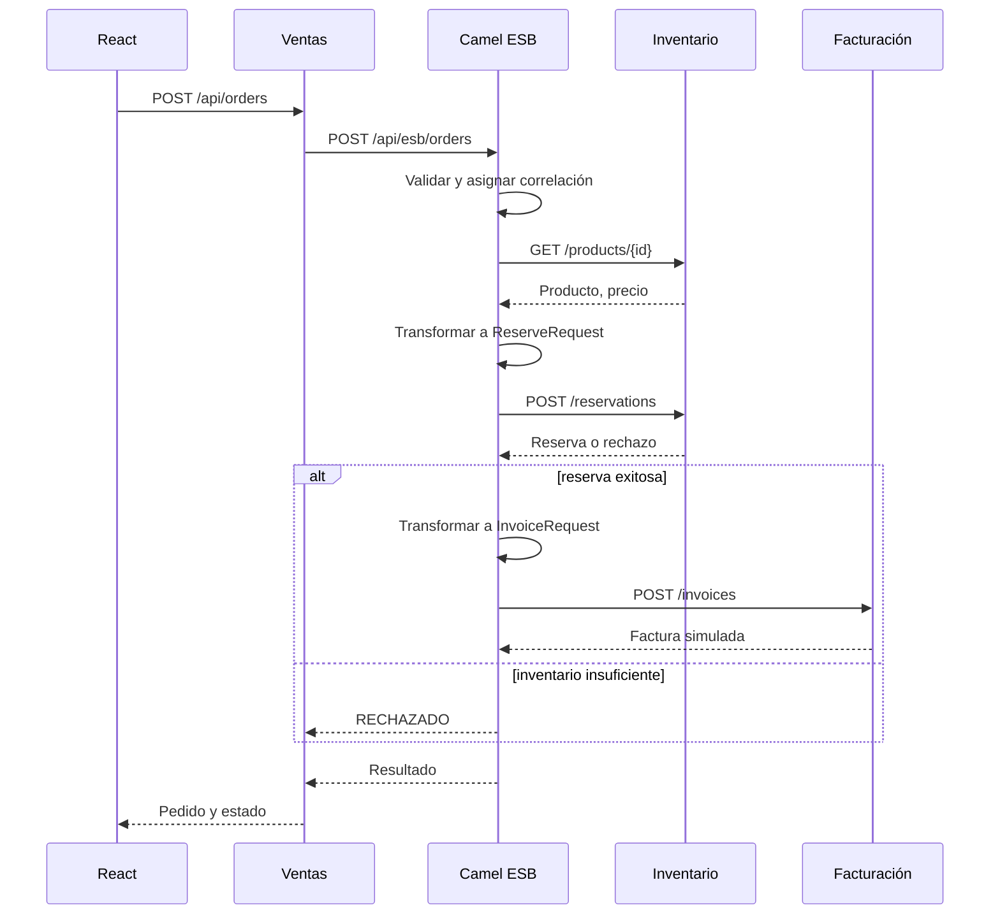

# Integración ESB

`IntegrationRoutes` contiene las rutas Camel `direct:products` y `direct:processOrder`. Camel valida, transforma mensajes JSON, enruta por HTTP mediante `toD`, usa `choice` para el rechazo y `onException` para errores. Ventas no conoce las APIs de inventario ni facturación. El encabezado `X-Correlation-Id` y logs con `orderId` permiten seguir la operación.

La reserva se hace con un `UPDATE ... WHERE stock>=quantity` atómico. La tabla `reservations` impide duplicados por ID de pedido. Facturación también impide facturas duplicadas con `UNIQUE(order_id)`. Ante fallo de facturación, la reserva persiste y el resultado queda pendiente para un reintento. No se aplica compensación automática ni transacción distribuida.
